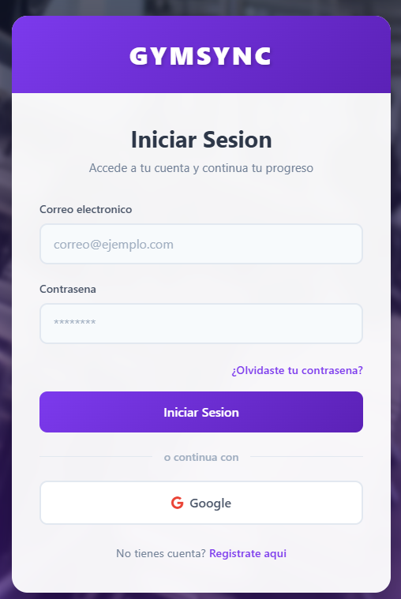
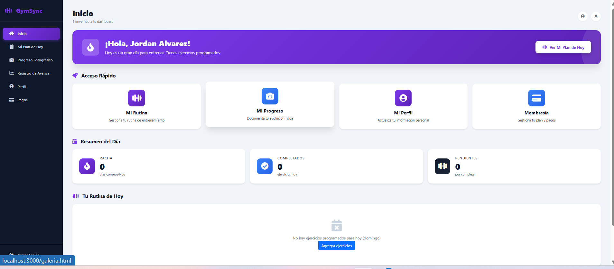
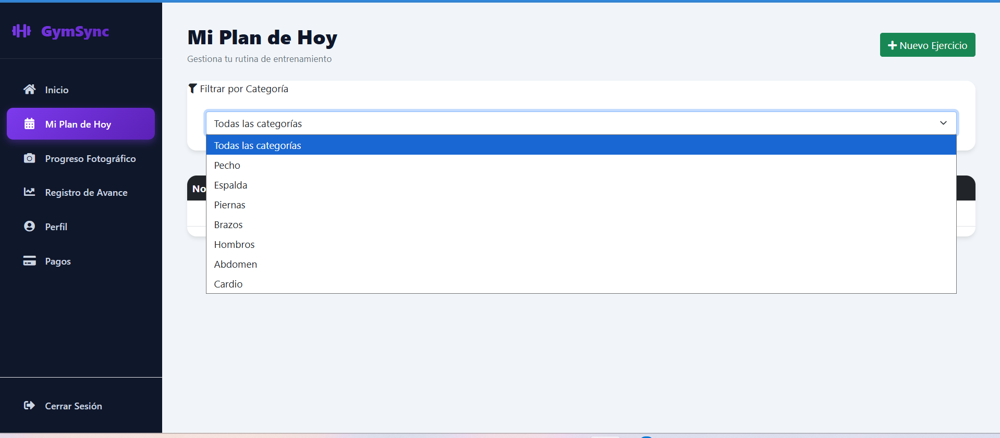
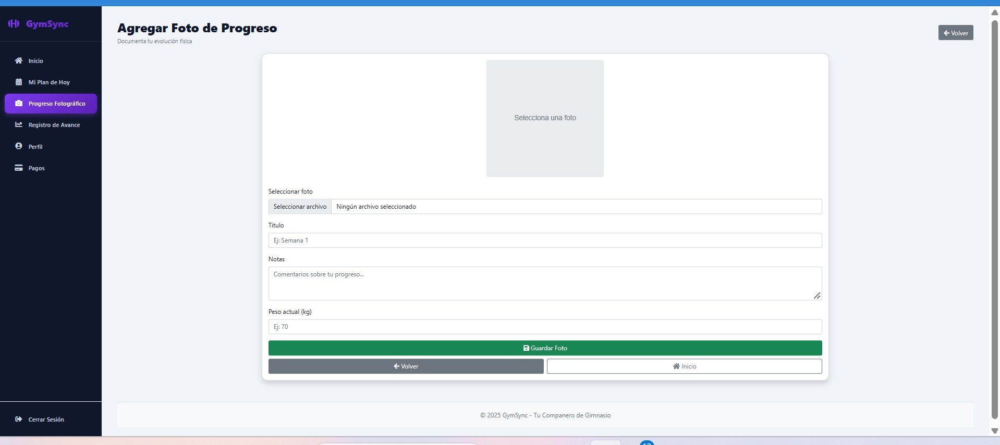

# GymSync - Tu Compañero de Gimnasio 🏋️‍♂️

## Integrantes
- **Integrantes**: [Jordan Alban Alvarez Vega], [Nombre del Estudiante 2 (Opcional)]
- **Curso**: Desarrollo de Aplicaciones Móviles

---

## 📌 Descripción del Proyecto

**GymSync** es una aplicación web progresiva (PWA) 
diseñada para usuarios de gimnasio que necesitan una 
herramienta completa para gestionar sus rutinas, seguir 
su progreso y mantenerse motivados. La aplicación combina 
la simplicidad de uso con funcionalidades avanzadas, 
utilizando tecnologías modernas para ofrecer una experiencia 
fluida tanto en dispositivos móviles como de escritorio.

La aplicación combina un rendimiento nativo fluido con una 
interfaz moderna basada en Material 3, conectándose a un 
backend escalable en Firebase para sincronización de datos 
en tiempo real.

---

## 📋 Cumplimiento de Requerimientos de la Asignación

La aplicación implementa formalmente todos los componentes requeridos:

1. **CRUD Completo**: 
   - Gestión de ejercicios y rutinas (Crear, Leer, Actualizar y 
     Eliminar ejercicios con categorías y series).
2. **Lista con Filtros Personalizados**: 
   - Listado de ejercicios con barra de búsqueda en tiempo real y
     filtros dinámicos por grupo muscular (Pecho, Piernas, Espalda, Abdomen, etc.).
3. **Acceso a Cámara o Galería (Imágenes o Video)**: 
   - Módulo de Galería de Progreso fotográfico, permitiendo capturar 
     imágenes con la cámara del dispositivo o seleccionarlas desde la 
     galería para registrar la evolución física.
4. **Diálogos (Dialogs)**: 
   - Alertas y diálogos de confirmación modulares para acciones críticas 
     como eliminar registros o confirmar pagos de membresías.
5. **Mapa**: 
   - Pantalla de ubicación con integración de mapas para encontrar 
     sucursales de gimnasios cercanas y puntos de interés.

---

## 🎨 Mockups de Pantallas y Diseño UX/UI

A continuación se detallan los wireframes y mockups conceptuales de las pantallas principales de la aplicación siguiendo buenas prácticas de UX (accesibilidad, áreas táctiles mínimas de 48dp, jerarquía visual clara y navegación intuitiva):

### 1. Pantalla de Autenticación (Login / Registro)


```
+-----------------------------------+
|          [ Logo GymSync ]         |
|         Tu Compañero Fitness      |
|                                   |
|  [ Correo electrónico           ] |
|  [ Contraseña                   ] |
|                                   |
|        [ INICIAR SESIÓN ]         |
|                                   |
|        ¿No tienes cuenta?         |
|             REGISTRATE            |
+-----------------------------------+
```

### 2. Dashboard Principal
* **UX Focus**: Resumen diario del usuario, acceso rápido a rutinas del día, racha de entrenamiento y barra de navegación inferior.



```
+-----------------------------------+
| Hola, Usuario!        [ 🔔 ] [👤] |
| Racha actual: 🔥 5 días           |
+-----------------------------------+
| Rutina de Hoy: Pierna & Core      |
| [ Ejercicio 1: Sentadillas      ] |
| [ Ejercicio 2: Peso Muerto      ] |
+-----------------------------------+
| [ Rutinas ] [ Ejercicios ] [ Mapa ] |
+-----------------------------------+
```

### 3. CRUD de Ejercicios & Lista con Filtros
* **UX Focus**: Búsqueda inmediata, chips de filtrado horizontal por categoría muscular y botón flotante (FAB) para agregar nuevos ejercicios.



```
+-----------------------------------+
| Buscar ejercicio...       [ 🔍 ]  |
| [Todos] [Pecho] [Piernas] [Espalda]|
+-----------------------------------+
| 🏋️ Press de Banca                 |
|    Grupo: Pecho | 4 series x 10 rep|
|    [ ✏️ Editar ]       [ 🗑️ Borrar ]|
+-----------------------------------+
| 🏋️ Sentadilla Libre               |
|    Grupo: Piernas | 4 series x 12 rep|
|    [ ✏️ Editar ]       [ 🗑️ Borrar ]|
+-----------------------------------+
|                                 + |
+-----------------------------------+
```

### 4. Galería de Progreso (Cámara / Galería)
* **UX Focus**: Cuadrícula visual antes/después, botón flotante accesible para capturar nueva foto con cámara o subir desde galería con indicador de peso y notas.



```
+-----------------------------------+
| Galería de Progreso      [ + Foto ]|
+-----------------------------------+
| +-------+   +-------+   +-------+ |
| |       |   |       |   |       | |
| | Foto1 |   | Foto2 |   | Foto3 | |
| | 75 kg |   | 74 kg |   | 73 kg | |
| +-------+   +-------+   +-------+ |
+-----------------------------------+
```

### 5. Mapa de Sucursales
* **UX Focus**: Mapa interactivo a pantalla completa con marcadores de ubicaciones de gimnasios y tarjeta de detalles al seleccionar un punto.
```
+-----------------------------------+
| Sucursales Cercanas       [ 📍 ]  |
+-----------------------------------+
|                                   |
|           [ Mapa GPS ]            |
|         (Google Maps / API)       |
|            📍 Gym Central         |
|                                   |
|  +-----------------------------+  |
|  | GymSync Center - 1.2 km     |  |
|  | Abierto hasta las 10:00 PM  |  |
|  +-----------------------------+  |
+-----------------------------------+
```

---

## 🛠️ Instrucciones de Configuración y Desarrollo

1. Clonar el repositorio.
2. Abrir el proyecto `GymSyncAndroid` en **Android Studio**.
3. Asegurarse de agregar el archivo `google-services.json` provisto por Firebase en el módulo `app/`.
4. Sincronizar el proyecto con Gradle (`Sync Project with Gradle Files`).
