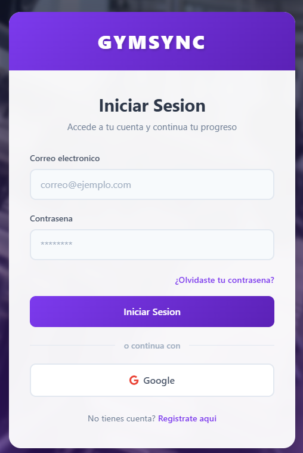
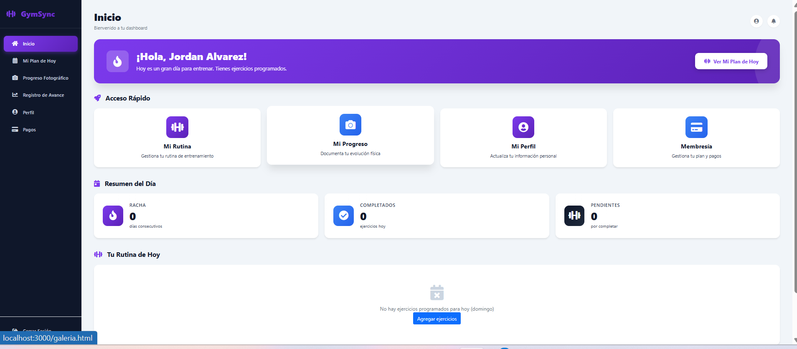
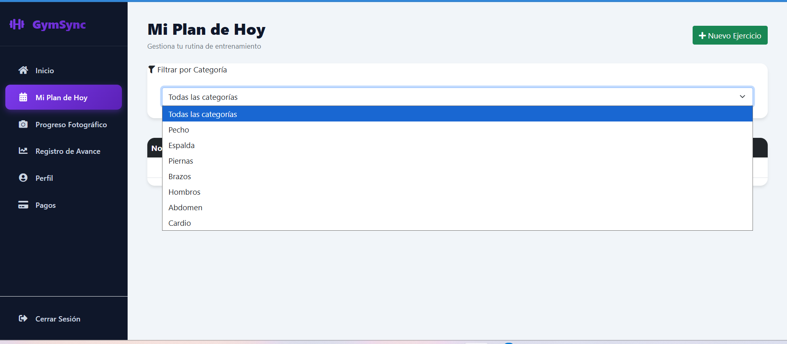
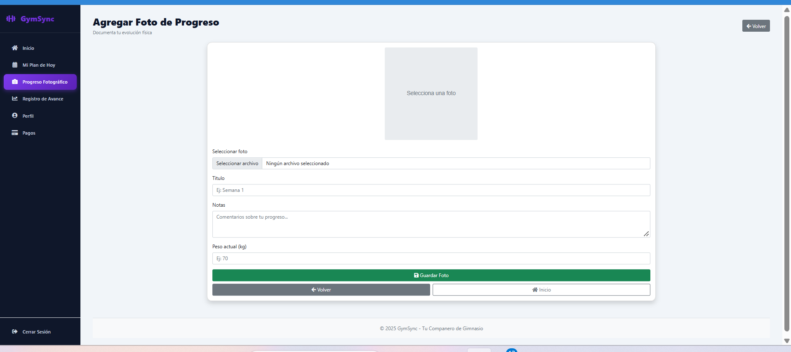

# GymSync - Tu Compañero de Gimnasio

## Datos del Estudiante
- **Estudiante**: Jordan Alban Alvarez Vega
- **Curso**: Desarrollo de Aplicaciones Móviles

---

## Descripción del Proyecto

**GymSync** es una aplicación móvil nativa en Android diseñada para usuarios de gimnasio que requieren gestionar sus ejercicios, rutinas de entrenamiento, seguimiento de progreso físico y ubicación de sucursales cercanas.

La aplicación está desarrollada en **Kotlin** aplicando buenas prácticas de desarrollo Android, el patrón de arquitectura **MVVM** (Model-View-ViewModel) y diseño de interfaz basado en **Material Design 3**.

---

## Arquitectura y Estructura del Código

El proyecto sigue una organización por capas limpias (Clean Architecture):

```text
com.example.gymsync/
├── data/
│   └── memory/
│       └── MemoryDataRepository.kt   # Carga y gestiona datos desde JSON en memoria
├── domain/
│   ├── model/                        # Modelos de datos del dominio
│   │   ├── Exercise.kt
│   │   ├── GymBranch.kt
│   │   ├── MuscleGroup.kt
│   │   ├── ProgressPhoto.kt
│   │   ├── Routine.kt
│   │   └── UserProfile.kt
│   └── repository/
│       └── GymSyncRepository.kt      # Interfaz que define las operaciones de datos
├── presentation/
│   ├── activity/                     # Pantallas y vistas de la aplicación
│   │   ├── AddEditExerciseActivity.kt
│   │   ├── DashboardActivity.kt
│   │   ├── ExerciseListActivity.kt
│   │   ├── GymMapActivity.kt
│   │   ├── LoginActivity.kt
│   │   ├── ProgressGalleryActivity.kt
│   │   └── RoutineListActivity.kt
│   ├── adapter/                      # Adaptadores para RecyclerViews
│   │   └── ExerciseAdapter.kt
│   └── viewmodel/                    # Gestión de estado para la UI
│       ├── DashboardViewModel.kt
│       ├── ExerciseViewModel.kt
│       ├── GymMapViewModel.kt
│       ├── ProgressGalleryViewModel.kt
│       └── RoutineViewModel.kt
└── util/                             # Clases de utilidad y validaciones
    ├── DateUtils.kt
    ├── UiState.kt
    └── ValidationUtils.kt
```

---

## Funcionalidades Implementadas

1. **CRUD Completo de Ejercicios**:
   - **Crear**: Agregar nuevos ejercicios definiendo nombre, descripción, grupo muscular, series, repeticiones y peso.
   - **Leer**: Renderizado dinámico de la biblioteca de ejercicios mediante `RecyclerView` y `ExerciseAdapter`.
   - **Actualizar**: Edición de datos precargando la información existente en el formulario.
   - **Eliminar**: Remoción de ejercicios directamente desde el listado.

2. **Cuadros de Diálogo de Confirmación**:
   - Diálogos emergentes con `MaterialAlertDialogBuilder` que solicitan confirmación previa del usuario antes de actualizar o eliminar un registro.

3. **Búsqueda y Filtrado en Tiempo Real**:
   - Barra de búsqueda interactiva para filtrar ejercicios por nombre o descripción.
   - Filtros horizontales por grupo muscular (Pecho, Piernas, Espalda, Abdomen, Brazos, Hombros, Cardio, Todos).

4. **Gestión de Datos mediante JSON**:
   - Los datos iniciales del proyecto no están hardcodeados en código Kotlin; se leen y procesan dinámicamente desde el archivo de assets `app/src/main/assets/gymsync_data.json` utilizando la librería nativa `org.json`.

5. **Soporte Multi-Idioma (Internacionalización)**:
   - Todo el código fuente está escrito en **Inglés**.
   - Soporte para dos idiomas en recursos de interfaz:
     - **Inglés (Predeterminado)**: `app/src/main/res/values/strings.xml`
     - **Español**: `app/src/main/res/values-es/strings.xml`

---

## Mockups de Pantallas y Diseño UX/UI

### 1. Pantalla de Autenticación (Login / Registro)


```
+-----------------------------------+
|          [ Logo GymSync ]         |
|         Tu Compañero Fitness      |
|                                   |
|  [ Correo electrónico           ] |
|  [ Contraseña                   ] |
|                                   |
|        [ INICIAR SESIÓN ]         |
|                                   |
|        ¿No tienes cuenta?         |
|             REGISTRATE            |
+-----------------------------------+
```

### 2. Dashboard Principal


```
+-----------------------------------+
| Hola, Usuario!                    |
| Racha actual: 5 días              |
+-----------------------------------+
| Rutina de Hoy: Pierna & Core      |
| [ Ejercicio 1: Sentadillas      ] |
| [ Ejercicio 2: Peso Muerto      ] |
+-----------------------------------+
| [ Rutinas ] [ Ejercicios ] [ Mapa ] |
+-----------------------------------+
```

### 3. CRUD de Ejercicios & Lista con Filtros


```
+-----------------------------------+
| Buscar ejercicio...       [ 🔍 ]  |
| [Todos] [Pecho] [Piernas] [Espalda]|
+-----------------------------------+
| Press de Banca                    |
| Grupo: Pecho | 4 series x 10 rep  |
| [ Editar ]             [ Borrar ] |
+-----------------------------------+
| Sentadilla Libre                  |
| Grupo: Piernas | 4 series x 12 rep|
| [ Editar ]             [ Borrar ] |
+-----------------------------------+
|                                 + |
+-----------------------------------+
```

### 4. Galería de Progreso


```
+-----------------------------------+
| Galería de Progreso      [ + Foto ]|
+-----------------------------------+
| +-------+   +-------+   +-------+ |
| | Foto1 |   | Foto2 |   | Foto3 | |
| | 75 kg |   | 74 kg |   | 73 kg | |
| +-------+   +-------+   +-------+ |
+-----------------------------------+
```

---

## Instrucciones de Configuración y Ejecución

1. Clonar el repositorio desde GitHub:
   ```bash
   git clone https://github.com/albdrag/GymSyncAndroid.git
   ```
2. Abrir el proyecto en **Android Studio**.
3. Sincronizar el proyecto con Gradle (`Sync Project with Gradle Files`).
4. Seleccionar un emulador o dispositivo Android conectado.
5. Hacer clic en **Run** (`Shift + F10`) para iniciar la aplicación.
